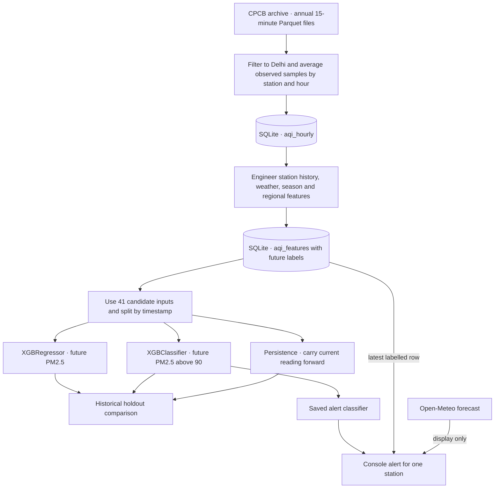
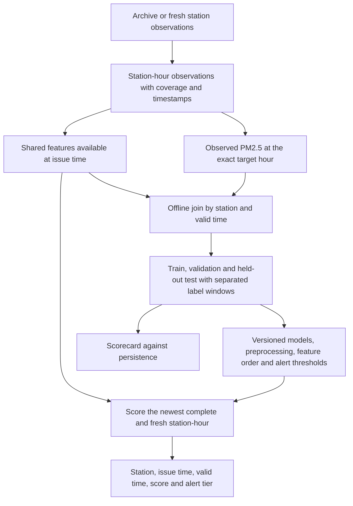

# Delhi air quality forecasting architecture

This project asks two questions about one station at the same hour tomorrow. **How high will PM2.5 be?** And **will it exceed 90 µg/m³?** The first model produces a concentration. The second produces an alert score. The archived run found little advantage in predicting the exact concentration and a more promising trade-off for alerts. The first engineering milestone is to verify the forecast clock and measure how often the model anticipates a new pollution episode.

This guide describes the implementation at `06b4c8f`. The benchmark figures come from the saved training transcript. The missing-hour example below was run separately against the feature code. [Source snapshot](https://github.com/Tanishqverma254997/delhi-ncr-aqi-forecasting/tree/06b4c8f9da26ba1408c3418d0c26ff025a812c8c) · [Training transcript](PROJECT_STATUS.md)

## Follow one forecast

Suppose the Anand Vihar hourly bucket is labelled Monday 08:00. Once its measurements are available, the intended target is that station’s PM2.5 in the Tuesday 08:00 bucket. If Tuesday’s reading is 100 µg/m³, the regressor is scored against 100 and the classifier against a positive label. The persistence baseline simply carries Monday’s reading forward. A forecast of pollution **onset** adds a condition: Monday’s reading must also be at or below 90.

Each example is one **station-hour**. Several stations or several consecutive hours can describe the same pollution episode. The target is a single hour’s PM2.5 concentration. Official AQI reporting uses pollutant-specific averaging windows and coverage rules. The project’s hourly “AQI” feature takes the maximum available hourly sub-index.

## How the current code runs

| Stage | What the code actually does | Where to look |
|---|---|---|
| Collect observations | Downloads annual 2022–2025 Parquet files from the Vonter CPCB archive. The filter is `State == "Delhi"`. The archived run reports 40 stations. Extending coverage to NCR cities in neighbouring states would require changing that filter. | [Historical ingestion](src/ingestion/fetch_cpcb_15min.py) |
| Make hourly records | Converts timestamps to Kolkata local time, floors to the hour and averages available quarter-hour samples. Each observed station/hour group becomes a row. A completely missing hour can disappear. The code stores the timestamp without a timezone or sample count. The README reports 1,367,285 hourly rows. | [Hourly aggregation](src/ingestion/fetch_cpcb_15min.py) |
| Describe conditions | Builds pollutant ratios, AQI lags and rolling statistics, PM2.5 changes, current weather, station identity and calendar signals. The regional mean uses reporting stations at that hour. The northwest feature averages five named station areas and falls back to the regional mean. It uses those concentrations as an indirect indicator of pollution arriving from the northwest. | [Feature construction](src/analysis/feature_engineering.py) |
| Build the learning dataset | Shifts each station’s PM2.5 forward by 24 **rows** to obtain the label. It also creates future-observed weather columns. The training allowlist excludes those columns, although the feature builder requires future wind and temperature for row retention. The trainer derives the binary label using strict `> 90`. | [Feature table](src/analysis/feature_engineering.py) · [Training inputs and targets](src/models/train_model.py) |
| Fit and score | Splits examples globally at the 70th and 85th percentiles of issue timestamps. Both XGBoost models fit on train plus validation. The script prints persistence comparisons and sweeps classifier thresholds on test. It writes two joblib files under `models/`. | [Training and evaluation](src/models/train_model.py) |
| Produce an alert | Loads the classifier and the latest stored feature row for one station, defaulting to Anand Vihar. A score of at least 0.25 prints Critical, 0.15 to below 0.25 prints Watch, and below 0.15 prints Normal. Open-Meteo supplies optional weather text keyed to the current clock. The output is a console printout. | [Alert CLI](src/predict_live.py) · [Weather advisory](src/ingestion/fetch_open_meteo_forecast.py) |

### Where the other files fit

- **Earlier data pipeline.** The Data.gov.in fetcher and database helper write `aqi_readings`. The historical seed script can append synthetic readings to that table. The exploratory notebook reads it, while the benchmark reads `aqi_hourly` and `aqi_features`. Running the seed script cannot recreate the benchmark. The historical weather script writes a separate `weather_history` table. [Fetcher](src/ingestion/fetch_cpcb.py) · [Database helper](src/database/db_operations.py) · [Seed data](src/analysis/load_historical_data.py) · [EDA](notebooks/01_exploratory_data_analysis.ipynb) · [Weather history](src/ingestion/fetch_weather_history.py)
- **Diagnostics.** The winter scripts examine persistence and seasonal prevalence. The chart script expects older columns such as `last_update`, `pollutant_id` and `lag_1`. Regenerating the chart from today’s schema requires the model’s saved input names and a comparison with observed PM2.5 at the forecast’s valid time. [Winter checks](scripts/) · [Chart script](src/visualize_model.py)
- **Clean checkout.** Git excludes the SQLite data and trained joblib files. Historical ingestion writes into a `data/` directory it assumes exists. A fresh environment needs a Parquet reader such as `pyarrow`, which the requirements file omits. The historical entry points run in the order ingestion → feature engineering → training → console inference. [Requirements](requirements.txt) · [Ignored artifacts](.gitignore) · [Run commands](README.md)

## What the old benchmark established

The recorded test covers **161,279 station-hours**, from 30 May through 31 December 2025. Persistence is a demanding baseline because pollution often remains in the same regime from one day to the next. [Historical results and confusion matrices](PROJECT_STATUS.md)

| Task | Persistence | XGBoost | Interpretation |
|---|---:|---:|---|
| Point forecast · mean absolute error | 35.0024 µg/m³ | 34.5681 µg/m³ | The average gain was 0.4343 µg/m³, about 1.2%. |
| Point forecast · root mean squared error | 60.3863 µg/m³ | 60.4317 µg/m³ | The model lost a little on the metric that gives large errors more weight. |
| Six-band accuracy from the point forecast | 54.39% | 54.17% | The small gain in average error did not improve category assignments. |
| Binary alert · missed positive station-hours | 6,498 | 2,552 at 0.25 | The model caught 3,946 more positive station-hours. |
| Binary alert · false positive station-hours | 5,927 | 9,205 at 0.25 | Catching them cost 3,278 additional false alarms. |

At 0.25, the classifier recorded 95.88% recall and 86.58% precision. The threshold was examined on the same test set used to report it. Also, a station already above 90 that stays above 90 counts as a successful alert. To answer “would we have warned someone before the air turned poor?”, report performance separately when the station starts at or below 90. Aggregate alert recall cannot answer that question.

## Three boundaries to repair

1. **Elapsed time.** The hourly aggregation emits observed groups. Subsequent lags, rolling windows and labels count rows. In a controlled run with hourly PM2.5 equal to the hour number, an issue at hour 40 correctly received label 64 on a complete series. Removing hour 45 changed its label to 65, even though hour 64 still existed. The test establishes the failure mode. Measuring its frequency requires the archive.
2. **Evaluation time.** The trainer partitions on the issue timestamp. A training example just before the next partition can use an answer observed inside that partition. The saved run even places the last validation issue at 22:00 and the first test issue at 23:00 on the same date. Weather medians are also estimated using a cutoff on the raw table, while the trainer calculates its cutoffs after row filtering. Give preprocessing and evaluation the same explicit cutoffs.
3. **Serving time.** Feature generation requires future labels and drops the newest rows. On a complete 100-hour example the newest eligible row was 24 hours behind the newest observation. The CLI reads that labelled table and may pair an archived pollution reading with weather for tomorrow relative to the wall clock. Its result describes a historical forecast unless fresh observations and a valid issue time are established.

## Architecture for the restart

Keep SQLite, the two model tasks and the existing source directories for the first comparison. Keeping the target and baseline fixed makes the effect of repairing the data pipeline measurable.

| Responsibility | Proposed home | Acceptance check |
|---|---|---|
| Station-hour clock and coverage | `src/ingestion/` | Keep a unique station/hour key, sample count and explicit timezone. Document when each hourly bucket closes and becomes usable. Count duplicate, partial and missing hours by station/year. |
| Shared features and offline labels | `src/analysis/` | Use an explicit hourly grid or timestamp joins. Fetch labels at exactly `t + 24 h` for the same station. A missing target yields an unscored example. Deleting a later reading cannot change features already available at issue time. The newest eligible hour can be scored before its label exists. |
| Fitting and evaluation | `src/models/` | Fit preprocessing on training data and save the station mapping and feature order. Require every training label time to precede validation start and every validation label time to precede test start. Choose an alert threshold on validation using a stated recall or false-alarm objective, then freeze the model and threshold. |
| Reproducible reporting | `scripts/` with generated reports kept per run | Record source versions, coverage, split dates, sample counts, dependencies and confusion matrices. Compare model and persistence on identical rows. Report point error, alert recall and false alarms by station, season and onset. Reserve a fresh chronological evaluation window for any new performance claim. |
| Inference and replay | `src/predict_live.py` | Distinguish historical replay from live scoring. Show the observation and forecast-valid times. Suppress live alerts for stale inputs. A replay using only information available then must produce the same feature vector as training for that station-hour. |

**Order of work.** First make ingestion reproducible and audit the archive for time gaps. Next repair labels, lags and split boundaries and reproduce the baseline. Then evaluate the alert threshold and onset performance. Connect fresh observations to the shared feature builder once historical replay passes. The first benchmark deliverable is a side-by-side scorecard with exact 24-hour labels and row counts for every exclusion. An improvement in skill is a result to measure.
